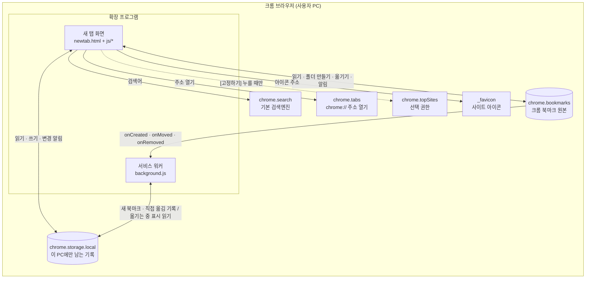
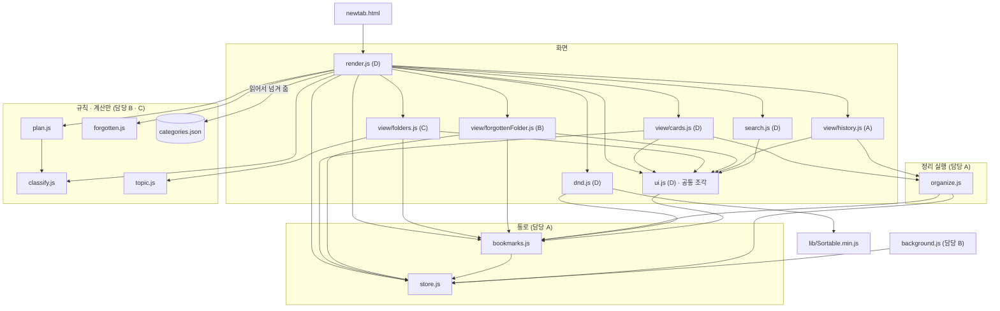
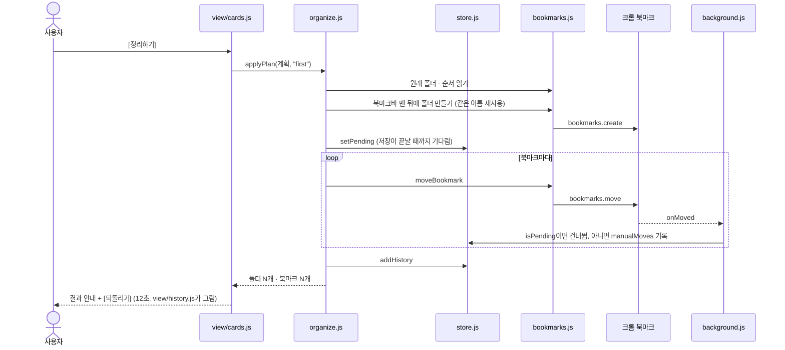

# 크롬 확장 프로그램 파일 구조도

> W6 기술 설계 · 시스템 아키텍처 (서버 없음 — 크롬 ↔ 확장 프로그램 파일 구조도)
> 근거: 서비스 계획(`service-plan.md`, 10월 6일 수정판), 기능명세·API명세(`spec.xlsx`, v13), 크롬 북마크 데이터 구조(`data-structure.txt`, 10월 6일 수정판), 확정 디자인 시안(10월 6일)
> 10월 7일 수정: 공통 화면 파일 `js/ui.js` 추가, 분류표와 정답지 추가, 저장소 규칙 확정 (11번)
> 그림: 구조_이미지.png (이 문서와 다른 곳은 9번 참고)
> 코드: 프로토타입 코드는 쓰지 않고 처음부터 새로 만든다(10월 6일 확정). 프로토타입을 돌려서 알아낸 사실은 이 문서와 명세에 "실행 확인"으로 남아 있다.

- 기술 스택: Manifest V3 (크롬 134 이상) · HTML / CSS / JavaScript (빌드 도구 없음, ES 모듈) · 백그라운드 서비스 워커 · SortableJS (폴더에 파일로 포함, CDN 사용 불가) · 서버·DB·AI 없음
- 권한: `bookmarks`, `storage`, `favicon`, `search` · 선택 권한 `topSites`
- 두 부분으로 구성: **새 탭 화면**(새 탭이 열려 있을 때만 동작) + **서비스 워커**(새 탭이 닫혀 있어도 북마크 알림을 받음)

---

## 1. 전체 그림



북마크 제목·주소는 확장 프로그램 밖(서버, 외부 API)으로 보내지 않는다 (F01-03).

---

## 2. 폴더 트리

코드는 `extension/` 폴더에만 두고, 문서와 테스트는 옆 폴더에 둔다(10월 6일 확정). 크롬에는 `extension/` 폴더만 올린다.

```
aix_BaroLink_bookmark/
├── extension/                 크롬에 "압축해제된 확장 프로그램"으로 로드하는 폴더 (코드만)
│   ├── manifest.json          설정: 권한, 새 탭 바꾸기, 서비스 워커 등록           담당 A
│   ├── background.js          서비스 워커: 새 북마크 · 직접 옮김 · 삭제 기록          담당 B
│   ├── newtab.html            새 탭 화면 뼈대 (HTML 안에 스크립트 직접 쓰지 않음)   담당 D
│   ├── newtab.css             새 탭 화면 모양 · 반응형                              담당 D
│   ├── js/
│   │   ├── bookmarks.js       크롬 북마크를 읽고 바꾸는 통로                        담당 A
│   │   ├── store.js           저장 항목을 읽고 쓰는 통로                            담당 A
│   │   ├── organize.js        정리 적용 · 되돌리기 (크롬 북마크를 실제로 바꿈)      담당 A
│   │   ├── classify.js        분류 규칙 · 정확도 측정 · 새 북마크 추천 (계산만)      담당 B
│   │   ├── forgotten.js       잊고 있던 북마크 고르기 (계산만, 화면은 8개까지)      담당 B
│   │   ├── plan.js            정리 대상(북마크바 포함) · 폴더 계획 · 고정 후보       담당 C
│   │   ├── topic.js           세부 폴더 제안 (P3)                                   담당 C
│   │   ├── render.js          화면 시작 · 전체 다시 그리기 · 헤더 · 고정됨 · 모든 북마크  담당 D
│   │   ├── ui.js              공통 화면 조각: 앱 아이콘 · 안내 문구 · 선 아이콘      담당 D
│   │   ├── view/
│   │   │   ├── cards.js           첫 정리 카드 · 고정 제안 · 정리 창 · 고르기 창     담당 D
│   │   │   ├── folders.js         내 폴더 줄 · 폴더 팝업 · 우클릭 메뉴               담당 C
│   │   │   ├── forgottenFolder.js 잊고 있던 북마크 폴더와 팝업                       담당 B
│   │   │   └── history.js         정리 결과 안내 · 정리 기록 화면                    담당 A
│   │   ├── search.js          웹 검색창 + 북마크 검색                               담당 D
│   │   └── dnd.js             드래그 이동 (P3, SortableJS)                          담당 D
│   ├── data/
│   │   └── categories.json    사이트 분류표 · 제목 키워드 · 분류하지 않는 사이트     담당 B
│   └── lib/
│       └── Sortable.min.js    SortableJS 파일 (CDN 금지라 폴더에 포함)
├── docs/                      서비스 계획 · 명세 · 이 구조도 · 데이터 구조 · 카테고리 정의 · 저장소 규칙 · 준비하는 법
│   └── design/                확정 시안의 코드 (참고용. 복사하지 않는다)
└── tests/                     샘플 북마크 세트 · 정답지 · 검증 목록
```

담당 A·B·C·D가 누구인지는 README의 담당 표에 GitHub 아이디로 적는다(공개 저장소라 실제 이름은 쓰지 않는다).

---

## 3. 파일별 역할

| 파일 | 하는 일 | 주요 함수 (명세 ID) | 쓰는 크롬 API | 담당(안) |
|---|---|---|---|---|
| `manifest.json` | 권한, 새 탭을 `newtab.html`로 바꾸기, 서비스 워커(`type: module`) 등록 | — | C01, C02 | A |
| `background.js` | 새 탭이 닫혀 있어도 북마크 알림을 받아 기록. 새 북마크는 `newBookmarks`, 우리 정리가 아닌 이동은 `manualMoves`에 기록. 가져오기 중엔 멈춤 | onCreated·onMoved·onRemoved 처리 (N32–N34) | bookmarks 알림, runtime.onInstalled (C03, C09, C10, C12, C13) | B |
| `js/bookmarks.js` | 크롬 북마크를 읽고 바꾸는 통로. 전체 읽기(기타 북마크가 두 개면 동기화되는 쪽), 폴더 만들기·이름·삭제(안의 북마크는 꺼냄), 옮기기, 열기, 파비콘 | loadTree, createFolder, moveBookmark, renameFolder, deleteFolderKeepChildren, openBookmark, faviconUrl (N01–N07) | bookmarks, tabs, favicon (C04–C08, C18, C22) | A |
| `js/store.js` | 저장 항목을 읽고 쓰는 통로. 읽고→고치고→쓰기를 한 함수로 묶어 순서대로 처리 | load, update, recordOpened, pin, dismiss, markManualMove, setPending/isPending, addHistory, cleanupMissing, setFirstCard, markHandledNew, addNew/removeNew/purgeWorkerKeys (N08–N16, N38–N40) | storage.local (C14, C15) | A |
| `js/organize.js` | 정리 적용: 원래 위치 읽기 → 북마크바 맨 뒤에 폴더 만들기 → '옮기는 중' 저장 → 옮기기 → 정리 기록. 되돌리기: 원래 바로 앞에 있던 북마크의 뒤에 놓아 순서를 복원, 직접 옮긴 것은 건너뜀 | applyPlan, undo (N22, N23) | bookmarks.js · store.js 경유 | A |
| `js/classify.js` | 분류표 → 주소 끝 → 제목 키워드 순으로 카테고리 하나. 정답지로 적용률·정확도 측정. 새 북마크 추천 폴더 | classify, measure, suggestForNew (N17, N18, N24) | 없음 | B |
| `js/forgotten.js` | 마지막으로 연 시각(우리 기록·dateLastUsed 중 최근 → 저장 시각) 계산, 30일 넘게 안 연 북마크를 오래 안 연 순으로 고르기. 화면은 앞의 8개만 보여 줌 | lastOpened, pickForgotten (N25, N26) | 없음 | B |
| `js/plan.js` | 정리 대상 고르기(북마크바·기타·모바일과 크롬 가져오기 폴더의 바로 아래에 흩어진 북마크. 사용자 폴더와 최근 30일 안에 북마크바에서 연 북마크는 제외), 폴더 개수·계획, 못 만들면 고정 후보 5개, 새 북마크가 모이면 새 폴더 제안 | getTargets, makePlan, pickPinCandidates, suggestNewFolders (N19–N21, N37) | 없음 (자주 방문한 사이트 목록은 render.js가 받아서 넘겨 줌) | C |
| `js/topic.js` | 큰 폴더 안 반복 주제 단어(북마크 3개+, 사이트 2곳+)로 세부 폴더 제안 (P3) | suggestSubfolders (N35) | 없음 | C |
| `js/render.js` | 화면의 시작점. 북마크·저장소 알림을 받아 전체를 다시 그리고, 각 화면 파일의 그리기 함수를 부름. 헤더·날짜·화면 아래의 고정됨(독)·모든 북마크는 직접 그림 | renderAll (N30) | bookmarks 알림, storage.onChanged (C09–C12, C16) | D |
| `js/ui.js` | 모든 화면 파일이 함께 쓰는 공통 화면 조각. 앱 아이콘(색 타일 위의 파비콘, 없으면 첫 글자), 짧은 안내 문구, 선 아이콘 12종 | appIcon, showToast, icon (N44–N46) | bookmarks.js 경유 (파비콘) | D |
| `js/view/cards.js` | 첫 정리 카드, 고정 제안 카드, 자세히 보기와 [정리하기] 창, 고정할 북마크 고르기 창. 고정 제안의 권한 요청과 자주 방문한 사이트 읽기 | showFirstCard, showOrganizeDialog, showPinPicker (N31) | permissions, topSites (C19–C21) | D (고정 제안은 C와 협업) |
| `js/view/folders.js` | 내 폴더 줄, 폴더 팝업(폴더 안의 폴더 포함), 폴더 만들기·이름 바꾸기·삭제, 우클릭 메뉴 | showFolders, openFolderPopup, showContextMenu (N41) | bookmarks.js 경유 | C |
| `js/view/forgottenFolder.js` | 잊고 있던 북마크 폴더(개수 배지)와 팝업. 8개까지 표시, 열기·고정하기·이제 안 봐도 됨·어디 있는지 보기 | showForgotten (N42) | bookmarks.js · store.js 경유 | B |
| `js/view/history.js` | 정리 결과 안내([되돌리기], 12초)와 정리 기록 화면 | showResultNotice, showHistory (N43) | organize.js · store.js 경유 | A |
| `js/search.js` | 웹 검색(위쪽 검색창. 주소면 이동, 아니면 기본 검색엔진)과 북마크 검색(모든 북마크 영역의 검색창. 제목·주소 부분 일치). 두 검색창은 연동하지 않음 | searchBookmarks, isUrlLike, runWebSearch (N27–N29) | search, tabs (C17, C18) | D |
| `js/dnd.js` | 끌어서 순서 바꾸기, 폴더 위에 놓기는 직접 구현 | initDnd (N36) | bookmarks.js 경유 | D |
| `data/categories.json` | 카테고리 9개의 사이트 분류표, 주소 끝 규칙, 제목 키워드, 분류하지 않는 사이트. 내용의 기준은 `docs/category-definitions.md` 10번 | — | — | B |
| `newtab.html` / `newtab.css` | 화면 뼈대와 모양. 스크립트는 모두 `.js` 파일에 두고 `addEventListener`로 연결 (MV3 제한). `newtab.css` 맨 위에 공통 값(색, 간격, 글자 크기, 둥글기)과 공통 모양(팝업 틀, 버튼, 목록 줄)을 둔다 | — | — | D |

---

## 4. 파일 간 관계

화살표는 "부른다" 방향이다. 크롬을 직접 부르는 곳은 `bookmarks.js`, `store.js`, `background.js`와 몇 군데(`search.js`의 검색·탭, `render.js`의 알림 받기, `view/cards.js`의 권한 요청·topSites)뿐이다. 규칙 층의 파일(`classify.js`, `plan.js`, `forgotten.js`, `topic.js`)은 파일도 크롬도 직접 읽지 않고, 필요한 값은 모두 입력으로 받는다. 분류표(`categories.json`)는 `render.js`가 읽어서 넘겨 준다.

화면 파일을 나눌 때 지키는 규칙은 일곱 가지다. 6번과 7번의 자세한 내용은 12번에 있다.

1. 크롬 북마크 알림과 저장소 알림은 `render.js`만 받고, 각 화면 파일의 그리기 함수를 부른다.
2. 화면 파일(`view/*`)끼리는 서로 부르지 않는다. 필요한 값은 `render.js`가 넘겨 준다.
3. 화면 파일은 크롬을 직접 부르지 않고 `bookmarks.js`와 `store.js`를 거친다. 고정 제안의 권한 요청만 `view/cards.js`에서 직접 한다.
4. 앱 아이콘, 짧은 안내 문구, 선 아이콘은 `ui.js`의 함수로만 그린다. `ui.js`는 모든 화면 파일이 불러 쓸 수 있고, `ui.js`는 화면 파일을 부르지 않는다. (10월 7일 추가. 확정 시안에서 네 담당의 화면이 같은 조각을 쓰는 것을 확인)
5. 팝업은 공통 함수를 두지 않고, 각 화면 파일이 HTML의 `<dialog>` 요소와 `newtab.css`의 공통 모양으로 만든다. Esc로 닫기는 `<dialog>`의 기본 동작이다. (10월 7일 추가)
6. 각 파일은 `newtab.html`의 자기 칸 안만 그린다. 남의 칸은 건드리지 않는다. (10월 7일 확정)
7. 다른 화면 파일의 동작이 필요하면 그 파일을 직접 부르지 않고, `render.js`가 넘겨 준 동작 묶음(`actions`)을 쓴다. (10월 7일 확정)



---

## 5. 저장 항목: 한 키는 한쪽만 쓴다

새 탭과 서비스 워커가 같은 키를 동시에 쓰면 한쪽 값이 사라진다(실행 확인: 120번 쓴 것 중 91개만 남음). 그래서 키마다 쓰는 쪽을 하나로 정했다. 모두 `store.js`를 거친다.

| 키 | 뜻 | 쓰는 쪽 | 읽는 쪽 |
|---|---|---|---|
| `pinned` | 독에 고정한 북마크 (최대 8개) | 새 탭 | 새 탭 |
| `lastOpenedByUs` | 우리 새 탭에서 연 시각 | 새 탭 | 새 탭 |
| `dismissed` | "이제 안 봐도 됨" | 새 탭 | 새 탭 |
| `handledNew` | [정리하기]에서 '그대로 두기'로 둔 새 북마크 | 새 탭 | 새 탭 |
| `history` | 정리 기록 (원래 폴더·순서 → 옮긴 폴더, 만든 폴더) | 새 탭 | 새 탭 |
| `state` | 첫 정리 카드 상태 | 새 탭 | 새 탭 |
| `pendingMoves` | 우리 정리가 옮기는 북마크와 목적지 (1분 뒤 만료) | 새 탭 | 서비스 워커 |
| `manualMoves` | 사용자가 직접 옮긴 북마크 | 서비스 워커 | 새 탭 |
| `newBookmarks` | 폴더 밖에 새로 저장된 북마크 | 서비스 워커 | 새 탭 |

---

## 6. 핵심 흐름: 정리 적용과 "직접 옮김" 구분



우클릭 이동·드래그·크롬 북마크 관리자에서의 이동은 '옮기는 중' 표시가 없으므로 서비스 워커가 똑같이 "직접 옮김"으로 기록한다.

---

## 7. 지난 구조도(10월 2일 안)에서 바뀐 점

기능명세서 v6의 파일 구성을 기준으로 맞췄다.

| 지난 안 | 바뀐 것 |
|---|---|
| `extension/` 하위 폴더 | 폴더 루트에서 바로 로드하기로 했다가, 10월 6일에 다시 `extension/` 하위 폴더로 확정 (코드와 문서를 분리) |
| `main.js` (시작점) | 없음. `render.js`가 화면 시작과 다시 그리기를 맡음 |
| `apply.js` (정리 적용·되돌리기) | `organize.js` |
| `pin.js` (고정 제안) | `plan.js`에 합침 (pickPinCandidates) |
| `websearch.js` | `search.js`에 합침 (웹 검색 + 북마크 검색) |
| `menu.js`, `panels/organize.js`, `panels/history.js` | `render.js`에 합쳤다가, 10월 6일에 `view/` 아래 화면 파일 4개로 다시 나눔 (2번) |
| 크롬 API 목록 | `chrome.tabs`(chrome:// 열기), `storage.onChanged`, `onImportBegan/Ended` 추가 |

## 8. 정해진 것과 남은 것

정해진 것 (10월 6일)

1. 프로토타입 코드는 쓰지 않고 처음부터 새로 만든다. 프로토타입에서 확인한 사실(옮기는 중 표시의 1분 만료, 저장 항목은 한쪽만 쓰기, 되돌릴 때 앞 이웃의 뒤에 놓기, 원래 순서를 옮기기 전에 한꺼번에 읽기)은 명세를 그대로 따르고, 프로토타입이 통과한 검증 목록은 `tests/`에 옮겨 새 코드의 확인 목록으로 쓴다.
2. 화면 그리기는 `render.js` 하나에 모으지 않고 `view/` 아래 파일 4개로 나눈다. 새로 만들기 때문에 처음부터 한 파일을 한 사람이 맡게 한다.
3. 권한 요청(topSites)은 `view/cards.js`에서 하고 결과만 `plan.js`에 넘긴다.
4. 코드는 `extension/` 폴더에만 두고, `docs/`와 `tests/`는 옆에 둔다.

정해진 것 (10월 7일)

5. GitHub 저장소는 `aix_BaroLink_bookmark`(공개)이고, 규칙은 `docs/conventions.md`에 있다.
6. 분류표(`extension/data/categories.json`)와 샘플 100개·정답지(`tests/`)를 만들었다. 정의는 `docs/category-definitions.md`에 있다.
7. 공통 화면 파일 `js/ui.js`를 추가했다 (4번의 규칙 4).
8. 화면 연결 방식을 정했다 (12번, 명세 v13).
9. 확정 시안의 코드를 `docs/design/`에 참고용으로 둔다.

남은 것

1. README의 담당 표에 GitHub 아이디 채우기 (팀이 직접 채움)
2. 서비스 이름 확정 (10월 7일 잠정: 바로링크 (BaroLink). `docs/design/App.tsx`의 로고는 "바로링크"로 고쳤고, Figma 원본의 로고는 아직 "바로")

## 9. 그림(구조_이미지.png)에서 고칠 곳

| 위치 | 지금 | 고칠 내용 |
|---|---|---|
| `js/plan.js` 칸 | "→ topSites (선택 권한)" | 삭제. `plan.js`는 크롬을 부르지 않는다 |
| `js/render.js` 칸 | 크롬 호출 표시 없음 | "→ permissions · topSites"를 파란 글씨로 추가 |
| `js/store.js` 칸 | 함수 9 | 함수 12 |
| `js/organize.js` 칸 | "undo: 원래 폴더 · 순서로 되돌리기" | 그대로 두어도 됨. 순서는 "원래 앞 이웃의 뒤" 방식으로 복원 |
| 머리말 | 기능명세 v6 기준 | v13 기준 |
| `js/` 칸 | `ui.js` 없음 | `ui.js` 칸 추가 (공통 화면 조각, 담당 D) |
| `js/render.js` 칸 | 화면 전체를 그림 | 시작·전체 다시 그리기·헤더·고정됨·모든 북마크만. `view/` 아래 파일 4개 칸 추가 |
| 폴더 전체 | 루트에 바로 `js/`, `data/`, `lib/` | `extension/` 폴더 안으로. `docs/`, `tests/`는 옆에 |
| `js/organize.js` 칸 | 폴더 만드는 위치 표시가 있다면 "기타 북마크" | "북마크바 맨 뒤" |
| `js/plan.js` 칸 | 정리 대상 설명 | "북마크바 포함, 요즘 쓰는 북마크 제외" |

## 10. 10월 6일에 바뀐 점

저장 항목은 그대로다. 규칙과 화면이 바뀌었고, 파일 구성은 화면 파일을 나누고 코드 폴더를 분리했다.

| 바뀐 것 | 내용 | 영향을 받는 파일 |
|---|---|---|
| 정리 대상 | 북마크바에 흩어진 북마크를 기본으로 포함. 최근 30일 안에 북마크바에서 연 북마크는 제외하고 개수에도 세지 않음 | `plan.js` (getTargets) |
| 폴더 만드는 위치 | 기타 북마크 안 → 북마크바 맨 뒤 | `organize.js`, `bookmarks.js` |
| 잊고 있던 북마크 | 화면에 8개까지만 표시. 기록이 없으면 "연 기록 없음" | `forgotten.js`, 화면 |
| 고정 제안 | "북마크바에 N개가 있어요" 질문 삭제 | 화면 |
| 화면 배치 | 고정됨은 화면 아래에 떠 있음. 웹 검색창과 북마크 검색창을 따로 둠. 정리 기록은 헤더 버튼으로 바로 엶. 고정됨의 [+]로 고르기 창을 엶 | `render.js`, `view/*`, `search.js`, `newtab.html`, `newtab.css` |
| 우선순위 | Must·Should → P1·P2·P3 | 문서 전체 |
| 화면 파일 | `render.js` 하나 → `render.js` + `view/` 아래 4개 | `render.js`, `view/*` |
| 코드 폴더 | 저장소 루트 → `extension/` 폴더 | 전체 |
| 프로토타입 | 쓰지 않고 처음부터 새로 만듦 | 전체 |

## 11. 10월 7일에 바뀐 점

| 바뀐 것 | 내용 | 영향을 받는 파일 |
|---|---|---|
| 공통 화면 파일 | `js/ui.js` 추가 (appIcon, showToast, icon). 화면 파일끼리 부르지 않는 규칙의 예외 | `ui.js`, `render.js`, `view/*`, `search.js` |
| 팝업 | 공통 함수 없이 `<dialog>`와 `newtab.css`의 공통 모양으로 만듦 | `newtab.css`, `view/*` |
| 분류표 형태 | `{ categories: [{ name, sites, suffixes, keywords }], noCategorySites: [] }` | `categories.json`, `classify.js`, `plan.js` |
| 분류하지 않는 사이트 | 뉴스·위키·검색 결과는 제목 키워드를 보지 않고 분류 안 됨 | `categories.json`, `classify.js` |
| 정확도 측정 | `measure`가 `{ coverage, accuracy, wrong }`을 돌려줌 | `classify.js` |
| 문서 이름 | 한글 이름 문서 세 개를 영어 이름으로 바꿈 | `docs/` |

## 12. 화면 연결 방식 (10월 7일 확정, 명세 v13)

### 칸: 누가 어디에 그리나

`newtab.html`에 칸이 있고, 칸마다 그리는 파일이 하나다. 칸 자체는 팀원 D가 만든다. 시안의 구역과의 대응은 `docs/design/README.md`에 있다.

| 칸 | 그리는 파일 | 내용 |
|---|---|---|
| `#header` | `render.js` | 이동 버튼, [정리하기], 정리 기록 버튼 |
| `#web-search` | `render.js` (`search.js` 사용) | 날짜, 웹 검색창 |
| `#organize-suggestion` | `view/cards.js` | 첫 정리 카드, 고정 제안 카드 |
| `#my-folders` | — | 내 폴더 구역. 아래 두 칸을 담는다 |
| `#forgotten-slot` | `view/forgottenFolder.js` | 잊고 있던 북마크 카드 (폴더 줄 맨 앞) |
| `#folder-list` | `view/folders.js` | 내 폴더 줄 |
| `#all-bookmarks` | `render.js` (`search.js` 사용) | 북마크 검색창, 모든 북마크 |
| `#dock` | `render.js` | 고정됨 |
| `#notice` | `view/history.js` | 정리 결과 안내 |
| `#toast` | `ui.js` | 짧은 안내 문구 |
| `#dialogs` | 각 화면 파일 | 각자의 `<dialog>`를 여기에 붙인다 |

`#forgotten-slot`과 `#folder-list`는 화면에서 한 줄로 이어져 보여야 한다(시안에서는 같은 격자 안에 있다). 두 칸을 한 줄로 잇는 것은 `newtab.css`의 일이다.

### 동작 묶음: 다른 화면 파일의 화면을 열어야 할 때

화면 파일끼리는 서로 부르지 않는다. `render.js`가 "할 수 있는 동작"을 묶어(`actions`) 그리기 함수에 넘겨 주고, 화면 파일은 그것을 부른다. 값을 `render.js`가 넘겨 주는 것과 같은 방식이다.

| 동작 | 실제로 불리는 함수 | 쓰는 곳 |
|---|---|---|
| `actions.openFolder(folderId)` | `view/folders.js`의 `openFolderPopup` | 잊고 있던 북마크의 [어디 있는지 보기] (F04-10) |
| `actions.showResultNotice(entry)` | `view/history.js`의 `showResultNotice` | 첫 정리 카드와 정리 창의 [정리하기] 뒤 (F07) |
| `actions.showContextMenu(bookmark)` | `view/folders.js`의 `showContextMenu` | 잊고 있던 북마크 목록의 우클릭 (P2, F15) |

`actions`를 받는 함수: `showForgotten(items, actions)`, `showFirstCard(plan, actions)`, `showOrganizeDialog(plan, actions)`.

동작을 더 넣어야 하면 명세(N30)를 먼저 고친다. 화면 파일이 다른 화면 파일을 `import`하는 것은 자동 검사가 막지 못하므로, 확인하는 사람과 CodeRabbit이 본다.

### 다시 그리는 규칙

- 북마크나 저장 항목이 바뀌면 알림이 `render.js`로 오고, `renderAll`이 그리기 함수들을 다시 부른다. 화면 파일은 "다시 그려 달라"고 요청하지 않는다. 예: [고정하기]는 `store.js`의 `pin`만 부르면 되고, 독은 알림을 받은 `render.js`가 다시 그린다.
- 그리기 함수는 여러 번 불려도 결과가 같아야 한다. 자기 칸을 비우고 다시 그린다.
- 열려 있는 `<dialog>`는 다시 그릴 때 닫지 않는다.

### 아직 정하지 않은 입력 (P2를 시작할 때 정한다)

- 새 북마크 정리 창(F10)에 넘길 값: 새 북마크와 추천 폴더
- 고정할 북마크 고르기 창(`showPinPicker`, F09)에 넘길 값: 고를 수 있는 북마크 목록

확정 디자인 시안: https://www.figma.com/make/Yf9dLbok1rcVJDNdDQAWI9/Chrome-Extension-UI
